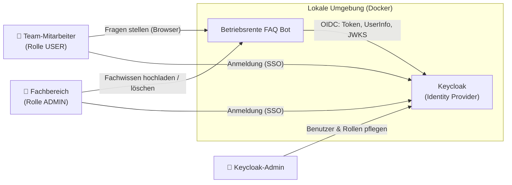
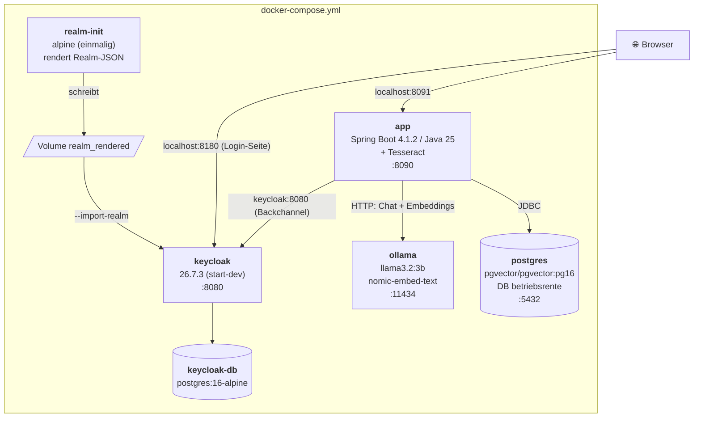
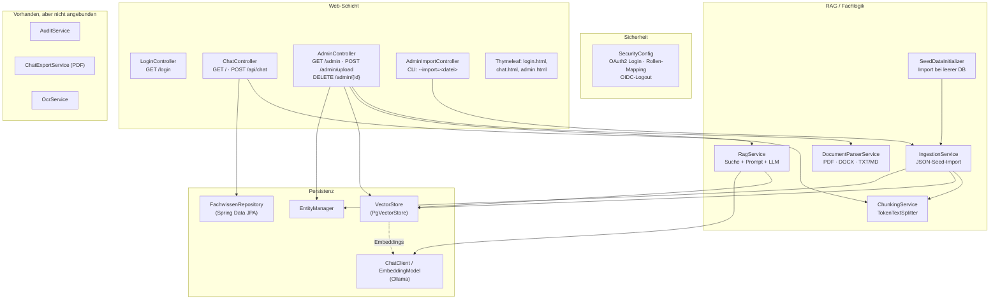
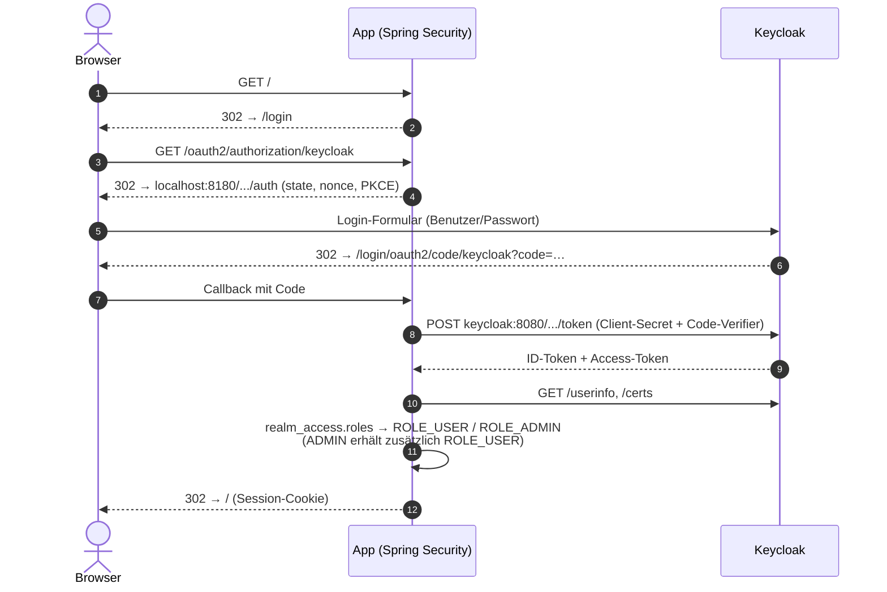
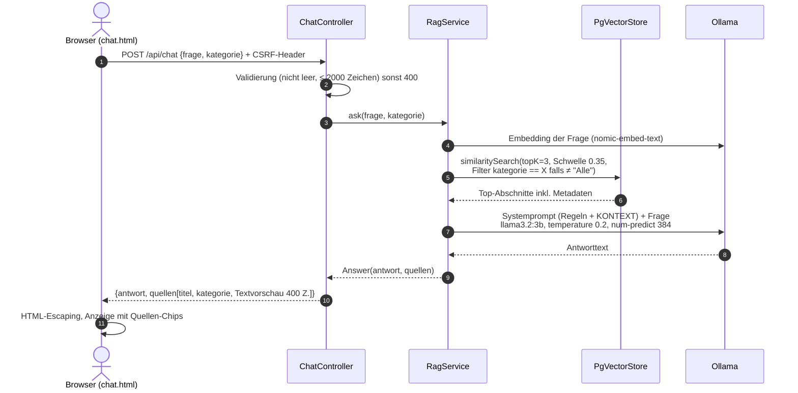
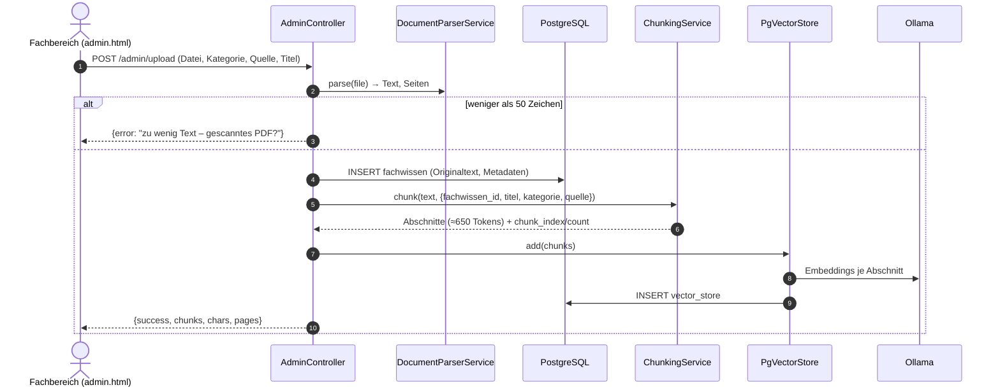
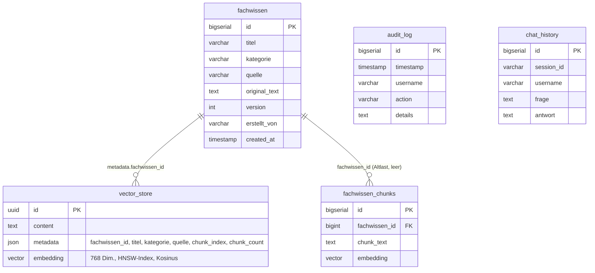

# Architektur – Betriebsrente FAQ Bot (Keycloak-Variante)

Lokal betriebener, deutschsprachiger FAQ-Chatbot für interne Teams zur Betriebsrente.
Er beantwortet Fragen per **Retrieval-Augmented Generation (RAG)**: Passende Abschnitte aus
freigegebenem Fachwissen werden per Vektorsuche gefunden und einem lokalen LLM als Kontext übergeben.
Es verlassen keine Daten die lokale Umgebung.

| Bereich | Technologie |
|---|---|
| Laufzeit | Java 25, Spring Boot 4.1.2 (Spring MVC, Thymeleaf, Data JPA / Hibernate 7) |
| KI | Spring AI 2.0.2, Ollama (`llama3.2:3b` für Antworten, `nomic-embed-text` für Embeddings, 768 Dimensionen) |
| Datenhaltung | PostgreSQL 16 + pgvector (HNSW-Index, Kosinus-Distanz), Flyway-Migrationen |
| Authentifizierung | Keycloak 26 (OIDC Authorization Code + PKCE), Spring Security OAuth2 Client |
| Dokumentverarbeitung | PDFBox 3 (PDF), Apache POI (DOCX), Tess4J/Tesseract (OCR, aktuell nicht angebunden) |
| Betrieb | Docker Compose |

---

## 1. Systemkontext



---

## 2. Container / Deployment



| Dienst | Host-Port → Container | Volume | Zweck |
|---|---|---|---|
| `app` | 8091 → 8090 | – | Web-UI, REST-API, RAG-Logik |
| `postgres` | 5445 → 5432 | `pgdata` | Fachwissen, Vektoren, Audit/Chat-Tabellen |
| `ollama` | 11435 → 11434 | `ollama_data` | LLM- und Embedding-Inferenz (CPU), `OLLAMA_KEEP_ALIVE=24h` |
| `keycloak` | 8180 → 8080 | – | OIDC-Provider, Realm `betriebsrente` |
| `keycloak-db` | – | `keycloak_data` | Keycloak-Persistenz |
| `realm-init` | – | `realm_rendered` | Ersetzt `${KEYCLOAK_*}`-Platzhalter in der Realm-JSON (Build-Kontext statt Bind-Mount) |

**Zwei Keycloak-URLs:** Der Browser nutzt `http://localhost:8180` (öffentlicher Issuer),
die App spricht intern mit `http://keycloak:8080` (Backchannel für Token, UserInfo, JWKS).
Deshalb wird die `ClientRegistration` in `SecurityConfig` manuell aufgebaut statt per Issuer-Discovery.

---

## 3. Komponenten der Anwendung



### Paketstruktur

```
de.team.betriebsrente
├── BetriebsrenteBotApplication      Einstiegspunkt
├── config/                          SecurityConfig, LoginController
├── controller/                      ChatController, AdminController, AdminImportController
├── model/                           JPA-Entitäten: Fachwissen, FachwissenChunks, AuditLog, ChatHistory
├── repository/                      FachwissenRepository
└── rag/                             RagService, ChunkingService, DocumentParserService,
                                     IngestionService, SeedDataInitializer,
                                     AuditService, ChatExportService, OcrService
```

---

## 4. Zentrale Abläufe

### 4.1 Anmeldung (OIDC Authorization Code + PKCE)



### 4.2 Frage beantworten (RAG)



Ohne passenden Kontext antwortet das Modell laut Systemprompt mit
*„Dazu liegt keine freigegebene Fachinfo vor. Bitte Fachbereich fragen.“*

### 4.3 Dokument hochladen (nur ADMIN)



### 4.4 Dokument löschen (nur ADMIN)

`DELETE /admin/{id}` entfernt in einer Transaktion
1. alle Vektoren mit `metadata.fachwissen_id == id` aus `vector_store`,
2. Altdaten aus `fachwissen_chunks`,
3. den Eintrag in `fachwissen`.

### 4.5 Seed-Import beim Start

`SeedDataInitializer` prüft beim Start, ob `fachwissen` leer ist. Falls ja, importiert der
`IngestionService` `testdaten/fachwissen_seed.json`. Die `training_phrases` jedes Eintrags werden als
„Beispielfragen“ an den Text gehängt, damit typische Formulierungen bei der Vektorsuche besser treffen.
Ein manueller Import ist per Startargument `--import=<pfad>` möglich.

---

## 5. Datenmodell



- `fachwissen`, `fachwissen_chunks`, `audit_log`, `chat_history`: per **Flyway** (`V1__init.sql`, `V2__audit_and_chat.sql`); Hibernate läuft mit `ddl-auto: validate`.
- `vector_store`: wird von **Spring AI** angelegt (`initialize-schema: true`) und ist die eigentliche Wissensbasis der Suche.
- `fachwissen_chunks`, `audit_log`, `chat_history` werden derzeit nicht beschrieben.

---

## 6. Sicherheit

| Thema | Umsetzung |
|---|---|
| Authentifizierung | Ausschließlich Keycloak (OIDC); keine lokalen Passwörter in der App |
| Autorisierung | `/admin/**`, `/api/admin/**` → `ROLE_ADMIN`; alles andere → `ROLE_USER` oder `ROLE_ADMIN`; `/login`, `/error`, `/css/**`, `/js/**`, OAuth2-Endpunkte öffentlich |
| Rollen-Mapping | Keycloak-Realm-Rollen `USER`/`ADMIN` aus `realm_access.roles` → Spring-Authorities |
| CSRF | Aktiv; Token per `<meta>`-Tag, von `fetch()` als Header mitgesendet |
| XSS | Frage und LLM-Antwort werden im Browser vor dem Einfügen HTML-maskiert |
| Logout | `OidcClientInitiatedLogoutSuccessHandler` beendet auch die Keycloak-Sitzung |
| Geheimnisse | `KEYCLOAK_*` über Umgebungsvariablen/`.env`; die Standardwerte sind nur für lokale Entwicklung gedacht |
| Datenschutz | LLM und Embeddings laufen lokal in Ollama; keine externen KI-Dienste |

---

## 7. Konfiguration (`application.yml`)

| Schlüssel | Wert | Bedeutung |
|---|---|---|
| `spring.ai.ollama.chat.options.model` | `llama3.2:3b` | Antwortmodell |
| `…chat.options.temperature` | `0.2` | Wenig Variation, faktentreu |
| `…chat.options.num-predict` | `384` | Max. Antwortlänge in Tokens |
| `spring.ai.ollama.embedding.options.model` | `nomic-embed-text` | Embedding-Modell (768 Dim.) |
| `spring.ai.vectorstore.pgvector.*` | HNSW, `COSINE_DISTANCE`, 768 | Vektorindex |
| `app.chunk.size` | `650` | Abschnittsgröße in Tokens |
| `app.keycloak.issuer-uri` / `backchannel-issuer-uri` | `localhost:8180` / `keycloak:8080` | Öffentlicher bzw. interner Keycloak |
| `app.ocr.*` | `deu+eng` | OCR-Einstellungen (Service nicht angebunden) |
| `RagService.TOP_K` / `SIMILARITY_THRESHOLD` | `3` / `0.35` | Anzahl und Mindestähnlichkeit der Kontextabschnitte (im Code) |

---

## 8. Qualitätssicherung

| Ebene | Umfang | Ausführung |
|---|---|---|
| Unit-Tests | 25 Tests (JUnit 5 + Mockito) für Controller, Services, Security | `mvn verify` (benötigt JDK 25) |
| UI-E2E | Playwright + TestNG für Chat und Admin, Backend-Antworten simuliert | `mvn -Pe2e … exec:java` (siehe README) |
| Coverage | JaCoCo-Report in `target/site/jacoco` | Phase `verify` |
| Bewertungsdaten | `testdaten/eval_dataset.json` | Manuelle Auswertung |

---

## 9. Bekannte Grenzen und nächste Schritte

1. **Antwortzeit:** Die Inferenz läuft nur auf der CPU. Mit 6 vCPUs/8 GB dauert eine Antwort etwa 20–60 s, unter 5 s geht es nur mit GPU.
2. **Nicht angebundene Funktionen:** `AuditService` (Audit-Log, Chatverlauf), `ChatExportService` (PDF-Export) und `OcrService` (gescannte PDFs) sind implementiert, werden aber nirgends aufgerufen.
3. **Altlast `fachwissen_chunks`:** Die Tabelle ist leer und wird nicht genutzt. Sie könnte per Flyway-Migration entfernt werden.
4. **Admin-Kategorien fest verdrahtet:** Das Upload-Formular bietet feste Kategorien an, der Chat-Filter liest sie dagegen aus der Datenbank.
5. **Kein Chunk-Overlap:** `TokenTextSplitter` unterstützt keine Überlappung zwischen Abschnitten.
6. **`.doc` (Word 97–2003)** wird wie DOCX behandelt und schlägt beim Parsen fehl. Dafür wäre `HWPFDocument` nötig.
7. **Keine Streaming-Antworten:** Die UI wartet auf die vollständige Antwort. Mit `ChatClient.stream()` und SSE würde die gefühlte Wartezeit deutlich sinken.
